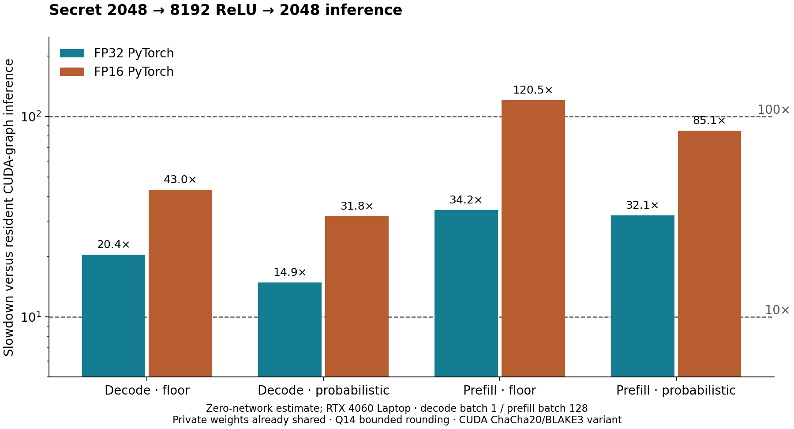

# Rep4 GPU inference results

The GPU variant meets the **less than 100×** target for the tested decode and
prefill blocks against both FP32 and FP16 PyTorch under a zero-network timing
model. This uses bounded probabilistic Q14 rounding. Exact floor rounding meets
the decode target but remains about 120× FP16 for prefill. A checked
4096 × 4096 matrix-vector product also meets the preferred **less than 10×**
target. Complete inference has not reached 10× FP16. The malicious-majority
online experiments have improved, but the original small-field native
preprocessor has a [confirmed privacy limitation](docs/native-mama-sacrifice.md#mask-privacy-limitation).
Its correctness and timing results do not establish secure dealer-free inference.

These results come from one RTX 4060 Laptop GPU with 8 GB of memory. The
four-party runtime executes real masks, messages, integrity checks, and secret
arithmetic. The independent-GPU numbers below are **estimates from isolated
party replay**, not measurements on four networked GPUs.

## Inference latency

The network is a secret-weight 2048 → 8192 ReLU → 2048 feed-forward block.
Inputs, both weight matrices, and both biases are privately shared. Floor mode
uses exact signed Q14 rescaling; its outputs equal the integer reference.
Probabilistic mode rounds each rescaling to its floor or ceiling, with unbiased
rounding under uniform fresh masks. Its outputs satisfy propagated integer
bounds and agree at all parties. Decode has batch size 1; prefill has batch size 128.

| Runtime and workload | Zero-network estimate | Versus FP32 graph | Versus FP16 graph | Measured four roles on one GPU | Evidence |
| --- | ---: | ---: | ---: | ---: | --- |
| BLAKE2b, ring32 decode | 14.91 ms | 23.0× | 46.9× | 65.85 ms | [JSON](results/inference_decode2048_ring32_q14.json) |
| BLAKE2b, ring64 decode | 20.90 ms | 33.3× | 65.8× | 77.19 ms | [JSON](results/inference_decode2048_ring64_q14.json) |
| BLAKE2b, ring32 prefill | 579.64 ms | 503.6× | 1681.0× | 1451.02 ms | [JSON](results/inference_prefill2048_ring32_q14.json) |
| GPU BLAKE3, floor decode | 13.70 ms | 20.4× | 43.0× | 79.51 ms | [JSON](results/final_device_floor_decode.json) |
| GPU BLAKE3, floor prefill | 42.62 ms | 34.2× | 120.5× | 181.62 ms | [JSON](results/final_device_floor_prefill.json) |
| GPU BLAKE3, probabilistic decode | 10.11 ms | 14.9× | 31.8× | 54.51 ms | [JSON](results/final_device_prob_decode.json) |
| GPU BLAKE3, probabilistic prefill | 29.51 ms | 32.1× | 85.1× | 123.56 ms | [JSON](results/final_device_prob_prefill.json) |



The BLAKE2b runtime retains MP-SPDZ's core message encodings and consistency
digests. Its benchmark uses AES-256-CTR correlated masks. The experimental GPU
runtime replaces mask generation with CUDA ChaCha20 and online digests with
BLAKE3, including its optional device-side output check in these final runs.
It preserves recipients, six joint inputs per multiplication, and
32-byte tag sizes; its cryptographic bytes are deliberately different.
See the [device protocol](docs/device-protocol.md).

The GPU BLAKE3 estimate assumes incoming online messages already reside on the
GPU. For the probabilistic variant, a replay that includes host staging instead
takes **12.16 ms for decode** and **51.58 ms for prefill**. That prefill result is
about **149× FP16**, so the GPU-incoming assumption matters to the target.
Physical GPUDirect networking is not implemented.
Both estimates exclude network latency and bandwidth. The measured four-role
column uses one shared GPU and includes contention between roles.

The probabilistic GPU decode is 3.31× the single-threaded NumPy baseline;
prefill is 0.323× NumPy. These CPU comparisons use the same
fixtures but are less demanding than FP16 CUDA inference. Floor mode's maximum absolute
log-probability error relative to FP32 is 0.00242 for decode and 0.00289 for
prefill. These are errors on generated fixtures, not language-model quality
measurements. Across the fresh probabilistic runs, the worst absolute
log-probability errors are 0.00252 for decode and 0.00291 for prefill.

The probabilistic prefill bound is 664,019,065 in encoded accumulator units,
strictly below its quarter-ring limit of 1,073,741,824. Propagated output
intervals span at most 40 Q14 integer units. The runtime does not privately
check this range for arbitrary models; the benchmark establishes it from its
public fixture before any sharing.

Exact prefill sends 352.72 MB of application payload globally in 25 rounds;
probabilistic prefill sends 239.60 MB in 20 rounds. Actual network bandwidth and
round latency remain additional deployment costs.

### Prepared inference graphs

Prepared local graphs, batched message hashes, direct receive buffers, and a
shorter post-truncation sign circuit reduce the measured probabilistic Q14
cost. The **less than 10× FP16 target remains unmet** for both workloads.
These runs use the same resident 2048 → 8192 ReLU → 2048 block, compact ring32
weights, and checked final opening as the eager GPU variant above.

| Workload | Eager before optimization | Prepared graphs | Versus FP16 graph | Host-staged estimate | Measured four roles on one GPU |
| --- | ---: | ---: | ---: | ---: | ---: |
| Decode, batch 1 | 9.51 ms | 3.57 ms | 12.8× | 4.44 ms | 16.88 ms |
| Prefill, batch 128 | 28.20 ms | 23.78 ms | 63.8× | 41.46 ms | 100.11 ms |

The [before measurement](results/rep4_opt_baseline.json) uses five samples;
the [final measurement](results/rep4_opt_final_verified.json) uses nine.
Absolute latency improves by 2.66× for decode and 1.19× for prefill. A separate
[nine-sample run](results/rep4_opt_final.json) measured 3.34 ms and 23.31 ms;
the table uses the final run rather than selecting the fastest result. FP16
denominators are measured in each run and vary, especially for prefill.

Both estimates exclude network latency and bandwidth. Device replay loads
recorded messages into the graphs' receive buffers before timing, matching its
already-delivered GPU assumption. Host replay includes transfers directly into
those buffers. Every timed replay still generates masks, hashes payloads,
checks received tags, and reproduces its recorded output. Fresh live samples
use advancing counters and agree at all four parties. Graph preparation is
reported separately as setup.

The shortened sign circuit preserves the probabilistic rounding contract and
reduces prefill traffic to 216.01 MB globally, with 20 rounds unchanged.
Graph execution can check tags immediately or allow local private scratch work
until the next send boundary. The reported run uses the latter option; all
pending checks finish before any dependent message or output is released.
The [device protocol guide](docs/device-protocol.md#prepared-inference-graphs)
defines the API, constraints, and reproduction command.

The optional [five-product prefill run](results/rep4_opt_five_prefill.json)
takes 23.54 ms and increases retained weight storage across four roles from
1.61 GB to 2.68 GB. It does not establish an end-to-end advantage. Paired
measurements also rejected [full-K accumulation](artifacts/fast_ring_compare.json),
[fused five-product preparation](artifacts/five_fused_compare.json),
[decode split-K/tile changes](artifacts/decode_split_compare.json), and
[four-lane hashing](artifacts/hash_four_lanes_compare.json); their slower
implementations are not selected or retained.

The focused regression passes **464 tests**, including private FFN transcript
equivalence, fresh nonces, malformed frames, tampered messages, graph failure
handling, range endpoints, trained inference, and separate-process socket
execution. See the [validation log](logs/rep4_opt_validation_final.log).

### Coalesced cryptography and activation fusion

Contiguous ChaCha20 stores, vectorized BLAKE3 loads, and four-byte joint-input
masks reduce memory traffic. The bounded carry circuit now computes its final
carry with one packed AND, without computing an unused propagate bit. Sign
extraction shares a kernel with conversion pair preparation. Truncation and
conversion also omit reads of components that their joint-input routes define
as public zeros. Graph plans cache their nonce schedules and combine multiple
pending check verdicts at each send boundary.

The [nine-sample measurement](results/rep4_next_final.json) retains the same
2048 → 8192 ReLU → 2048 model, ring32 Q14 precision, fresh online masks,
checked output opening, and GPU-delivered replay assumptions. The **less than
10× FP16 target remains unmet** for both workloads.

| Workload | Previous estimate | Current estimate | Versus FP16 graph | Host-staged estimate | Measured four roles on one GPU |
| --- | ---: | ---: | ---: | ---: | ---: |
| Decode, batch 1 | 3.572 ms | 3.455 ms | 12.36× | 4.333 ms | 17.872 ms |
| Prefill, batch 128 | 23.780 ms | 20.357 ms | 55.40× | 39.125 ms | 89.622 ms |

These point estimates reduce decode latency by 3.3% and prefill latency by
14.4% relative to the prior verified run. The current FP16 graph baselines are
0.2796 ms and 0.3674 ms, measured in the same run. Both replay estimates exclude
network latency and bandwidth; the colocated column includes contention among
four roles on one GPU. See the [comparison summary](results/rep4_next_summary.json).

The two prefill phases containing the matrix products account for 9.67 ms,
including their local protocol work, against a 3.67 ms budget for the entire
block to reach 10× FP16. Persistent accumulators, uint32 MMA barriers, and
cuBLAS limb products did not improve both layer shapes, so the existing
matrix kernel remains selected. The retained
[accumulator experiments](artifacts/prefill_persistent_accumulators.json) and
[concatenated cuBLAS experiments](artifacts/prefill_cublas_concat.json) record
the comparisons and exact-output checks.

The protocol still takes 20 rounds. Prefill payload falls from 216.01 MB to
215.22 MB globally because the final carry multiplication uses half as many
packed words. All fresh outputs agree across parties and satisfy the original
rounding bounds; every replay exactly reproduces its recorded output. Maximum
absolute log-probability error is 0.00245 for decode and 0.00291 for prefill.
The focused regression passes **542 tests**, covering CPU cryptographic
oracles, exact transcripts, fresh graph nonces, boundary carries, tampering,
trained inference, and socket execution. The
[validation log](logs/rep4_next_validation.log) and
[exit status](logs/rep4_next_validation.status) retain the results.

### Packed activation messages and small-message hashing

The bounded sign path packs its consumed bits before joint sharing and keeps
the packed shares through carry evaluation and sign conversion. Ring32 Q14
uses 18 bits per activation in the initial Boolean exchanges instead of 32.
Aligned full-chunk BLAKE3 messages up to 32 KiB use coalesced shared-memory
loads and a warp-local parent tree. Graphs also capture verdict transfers into
retained pinned host buffers; checks still finish before dependent sends.

The [nine-sample measurement](results/rep4_packed_final.json) keeps the same
model, precision, fresh masks, checked output opening, and timing boundaries.
The **less than 10× FP16 target remains unmet** for both workloads.

| Workload | GPU-delivered estimate | FP16 graph baseline | Slowdown | Host-staged estimate | Measured four roles on one GPU |
| --- | ---: | ---: | ---: | ---: | ---: |
| Decode, batch 1 | 3.007 ms | 0.2797 ms | 10.75× | 3.953 ms | 16.951 ms |
| Prefill, batch 128 | 19.535 ms | 0.4039 ms | 48.36× | 35.667 ms | 86.888 ms |

The [paired comparison](results/rep4_packed_paired.json), before the final hash
specialization, measured prefill at 20.483 ms before packing and 19.454 ms
afterward, a 5.0% reduction. Decode measured 3.015 ms and 3.071 ms; packing did
not establish a decode latency gain. The retained hash kernel separately
reduces batch-two graph timings from 12.48 to 10.39 µs for 8 KiB messages and
13.98 to 12.25 µs for 18 KiB messages in an
[alternating kernel comparison](artifacts/hash_small_retained_compare.jsonl).

FP16 prefill timings vary between runs. Using the previous report's 0.3674 ms
denominator, the new prefill estimate is 53.17×. The change from 55.40× to
48.36× therefore includes baseline variation. Both replay estimates exclude
network latency and bandwidth; physical GPUDirect networking remains absent.

Prefill sends 200.54 MB globally instead of 215.22 MB, a 6.8% reduction, with
20 rounds unchanged. Fresh outputs agree across all parties and satisfy the
same propagated rounding bounds; every replay reproduces its recorded output.
Maximum absolute log-probability error is 0.00251 for decode and 0.00290 for
prefill. The two prefill matrix-product phases still total 9.83 ms, against a
4.04 ms budget for the entire inference to reach 10× the current FP16 baseline.
The [comparison summary](results/rep4_packed_summary.json) retains these values.

The focused regression passes **611 tests**, including every small-message
hash chunk count from 1 through 32, mixed binary word widths, packed carry
boundaries, fresh graph inputs and nonces, failed checks before sends, trained
inference, and socket execution. See the
[validation log](logs/rep4_packed_validation.log) and
[exit status](logs/rep4_packed_validation.status).

## Sparse products and activation experiments

The optional `sparse_products=True` path removes two public-zero contributions
from selected truncation, bounded-sign, and conversion products. Its balanced
four-contribution route preserves the existing Rep4 sharing model and the
rounding contract. It reduces prefill traffic from 200.54 MB to **176.95 MB**
with 20 rounds unchanged. A [nine-sample ReLU run](results/activation_inference.json)
measures 3.242 ms decode and 19.031 ms prefill. The earlier packed run measured
3.007 and 19.535 ms; these separate runs establish no decode latency gain.
The [protocol description](docs/device-protocol.md#products-with-public-zero-components)
specifies the public support invariant and altered mask schedule.

The activation experiments use the same 2048 → 8192 → 2048 secret-weight
fixture, Q14 ring32, prepared GPU graphs, fresh masks, and checked output
opening. No TEE was used. The table reports GPU-delivered isolated-party
estimates; all network latency and bandwidth are excluded.

| Activation path | Decode | Prefill | Rounds | Prefill traffic | Prefill logit RMSE | Prefill top-1 agreement |
| --- | ---: | ---: | ---: | ---: | ---: | ---: |
| Private ReLU with sparse products | 3.242 ms | 19.031 ms | 20 | 176.95 MB | 0.000633 | 100% |
| Private local quadratic GELU | 2.929 ms | 17.718 ms | 14 | 155.19 MB | 0.023282 | 89.84% |
| Private local quadratic SiLU | 3.009 ms | 17.784 ms | 14 | 155.19 MB | 0.011026 | 92.19% |
| Public-fixture helper simulation, ReLU | 2.611 ms | 14.085 ms | 9 | 79.69 MB | 0.000633 | 100% |

Accuracy compares each case with its original floating activation. These are
synthetic FFN outputs, not trained language-model accuracy. The two local
polynomials are `x/2 + 3*x*x/8` for GELU and `x/2 + x*x/4` for SiLU. They
need one secret square and avoid secure comparisons, but change the network
function. On a dense `[-4,4]` grid their maximum activation errors are 4.00013
and 2.07195 respectively. They work better near zero and do not clip tails.
The earlier uniform quadratics give much poorer fixture quality: prefill top-1
agreement is 35.94% for GELU and 56.25% for SiLU. See the
[activation API and contracts](docs/activations.md),
[uniform measurements](results/activation_inference.json), and
[local measurements](results/activation_local_inference.json).

The [helper simulation](results/activation_simulated_inference.json) executes
two ordinary GPU helpers that reconstruct the activation, floor-rescale it,
apply ReLU, and create fresh full four-component output shares. It includes
actual masks, hashes, reconstruction, and resharing. It provides **no enclave
isolation or activation privacy**. This changed trust model cannot be reported
as a faster private Rep4 implementation. Its activation route costs eight
ring words per element globally plus 128 tag bytes in two exchanges; the
complete inference retains the later private rescaling and checked opening.
The [simulation guide](docs/activation-helper-simulation.md) describes the route
and its limitations.

Against each run's original-activation FP16 graph baseline, the simulation is
9.34× for decode and 32.10× for prefill. Local quadratic GELU is 10.47× and
45.04×; local quadratic SiLU is 10.67× and 35.10×. FP16 prefill timing varies
between runs, so latency and quality columns are more useful than comparing
these ratios directly. The simulated ReLU latency is 19.5% lower for decode
and 26.0% lower for prefill than the sparse ReLU measurement. The **less than
10× target for both workloads remains unmet**.

### Blinding and duplicated helpers

The [public blinding experiments](artifacts/activation_blinding_public_gpu.json)
expose the limits of shift, scale, and permutation masking. Softmax shift and
permutation preserve sorted gaps and the probability multiset. Large shifts
can also lose floating-point precision: the FP16 offset example changes a
probability by 0.332. RMS scaling preserves normalized ratios; fixed epsilon
breaks exact invariance, while revealing scaled epsilon can disclose the
scale. Permutation and padding leave actual GELU inputs visible within a
larger multiset. These transformations do not hide all activation information
from a compromised helper.

Duplicate deterministic execution and matching output hashes detect some
inconsistent results, but cannot detect identical errors or establish privacy.
The public replica experiment enforces fresh nonces and rejects independent
corruption; it implements no enclave or attestation. Slalom's
[TEE-assisted design](https://www.floriantramer.com/docs/papers/iclr19slalom.pdf)
places the remaining network computation inside its trusted environment and
outsources linear layers; it does not establish that these blinding transforms
protect activations from a compromised TEE. For a pure MPC direction,
[Compact](https://petsymposium.org/popets/2024/popets-2024-0065.php) studies
input-distribution-aware piecewise polynomials. Its reported model quality
does not validate the quadratics used here.

The [phase-deletion counterfactual](results/activation_cost_bounds.json)
puts prefill at 10.46 ms even if the first activation stage were free. Its two
matrix phases alone total 9.66 ms. These estimates delete existing phases and
are not measurements of a replacement protocol, but they show why activation
work alone does not close the prefill gap. The
[combined summary](results/activation_summary.json) retains measured results,
quality metrics, source hashes, and evidence links.

The combined regression passes **738 tests** in 137.52 seconds, including
fresh-mask integer oracles, full-width sparse products, phase-graph replay,
corruption rejection, trained fixtures, and socket execution. The 12 warnings
are empty CUDA graph segments for roles without local work between exchanges.
See the [validation log](logs/activation_full_validation.log) and
[successful exit status](logs/activation_full_validation.status).

## Exact Strassen products and narrower truncation corrections

The private ReLU path now has two exact matrix improvements and an optional
smaller truncation correction. The SM89 compact-weight kernel uses explicit
modular additions and a `32/128/32` tile. The optional `strassen32` format adds
one level of batched matrix Strassen with cached static weight combinations.
Neither matrix change alters the local ring products, rounding, wire bytes,
or cryptographic checks. `narrow_products=True` changes selected correction
messages to 16-bit arithmetic while preserving the probabilistic rounding law.
The [kernel guide](docs/kernel-arithmetic.md) and
[truncation contract](docs/device-protocol.md#narrow-truncation-correction-products)
explain the identities and input requirements.

| Workload and storage | GPU-delivered estimate | FP16 graph baseline | Slowdown | Host-staged estimate | Four roles on one GPU |
| --- | ---: | ---: | ---: | ---: | ---: |
| Decode, `words32`, narrow corrections | 3.354 ms | 0.2796 ms | 12.00× | 4.183 ms | 16.803 ms |
| Prefill, `words32`, modular-add kernel | 17.642 ms | 0.3736 ms | 47.22× | 33.006 ms | 79.119 ms |
| Prefill, `strassen32`, modular-add kernel | **16.432 ms** | 0.3542 ms | **46.39×** | 31.160 ms | 71.536 ms |

These [nine-sample compact-weight measurements](results/rep4_narrow_opaque.json)
and [Strassen measurement](results/rep4_strassen_narrow.json) include narrow
corrections, fresh masks, checked output opening, and the original private
ReLU activation. All outputs agree across parties and remain inside the same
public Q14 rounding bounds. Maximum log-probability error is 0.002512 for
decode and 0.002906 for prefill, with 100% top-1 agreement on the synthetic
fixture. No polynomial substitution or trusted-helper reconstruction is used.

Compared with the earlier sparse-product run at 19.031 ms, Strassen prefill
latency is 13.7% lower. These are separate runs; their FP16 baselines also vary.
The current decode run establishes no latency gain over the earlier 3.007 ms
packed configuration. The less than 10× target remains unmet for both
workloads. The current Strassen matrix phases alone total 7.529 ms, above the
3.542 ms budget for the entire prefill block to meet 10× its FP16 baseline.

The [alternating modular-add comparison](artifacts/opaque_ring32_paired.json)
measures 5.271 → 4.738 ms and 5.510 → 4.969 ms for the two local matrix shapes,
about 10% lower each. The [alternating Strassen comparison](artifacts/rep4_strassen_opaque_paired.json)
then measures 4.732 → 3.796 ms and 4.794 → 4.019 ms relative to that optimized
kernel. Every measured full-ring output matches exactly. Separate contribution
launches regressed; two Strassen levels also regressed the down projection.
Neither is selected by inference dispatch.

Strassen increases retained model storage from 402,653,184 to 704,643,072 bytes
per party, or 1.75 times the compact format. The four colocated roles retain
2,818,572,288 weight bytes. All query-dependent input sums and output joins
remain inside inference timing; only static weight sums are prepared once.
Single-row decode uses `words32`; the Strassen format requires even batch and
matrix dimensions.

Narrow correction products reduce prefill payload from 176,949,760 to
166,464,000 bytes globally, a 5.93% reduction, with 20 rounds unchanged. They
use separate mask domains and full 32-byte tags. For a correction multiplied
by `-2**(bits-shift)`, a lift error divisible by `2**16` vanishes in the full
ring whenever `shift <= 16`. Larger shifts keep the full-width route.

Reproduce the Strassen prefill case from the repository root:

```sh
python -m benchmarks.device_inference --batch 128 --width 2048 \
  --bits 32 --binary-bits 32 --fractional-bits 14 \
  --prepared --weight-storage strassen32 --optimized --gpu-open \
  --rounding probabilistic --bounded-sign --phase-graphs \
  --graph-check-at-send --sparse-products --narrow-products --repeats 9 \
  --output results/rep4_strassen_narrow.json
```

The [combined report](results/rep4_strassen_narrow_summary.json) retains source
hashes, phase estimates, storage costs, and validation evidence.

The final regression passes **895 tests** in 91.65 seconds. It includes
full-width integer matrix oracles, the saturation regression, Strassen
transcript parity, independent ChaCha20/BLAKE3 narrow-product oracles,
corrupted-message rejection, fresh graph inputs, trained fixtures, and socket
execution. The 12 warnings are empty CUDA graph segments for roles with no
local work between exchanges. See the
[validation log](logs/rep4_strassen_narrow_validation_final.log) and
[exit status](logs/rep4_strassen_narrow_validation_final.status).

## Matrix multiplication

For a secret `(1, 4096) @ (4096, 4096)` product in ring32, the checked
zero-network estimate is **1.326 ms**, or **3.82× FP32 and 8.29× FP16**
CUDA-graph matrix multiplication. The measured four-role colocated time is
4.885 ms. It sends 98,496 application bytes globally in one communication
round. This timer includes masks, BLAKE2b checks, and resharing; output opening
is verified separately and excluded from this primitive's timer.
[Nine-sample evidence](results/primitives_decode_words32.json).

Prepared weights store each ring32 component in four bytes. A party holds
three components, so its resident weight storage is six times that of a
single FP16 plaintext weight matrix. The decode kernel computes the three
local multiplication contributions directly from those words. Larger matrix
products use exact balanced int8 limb products and tensor cores; they do not
cast secret ring values to approximate floating-point arithmetic.

## Correctness and communication evidence

The combined regression passes **1,438 tests and 8 subtests**, including the
trained GPU model and separate-process TLS configurations. The subsequent
direct-q256 addition passes 45 focused tests and native role-local checks.
[Validation summary](results/malicious_final_all_validation.json),
[complete regression log](logs/pytest_malicious_final_all.log),
[direct-field test log](logs/pytest_prime256_final.log).

- An independent Rep4 oracle compares recipients, protocol phases, payloads,
  digests, and local replicated components. Input ownership and checked opening
  are covered separately. Transport framing is custom, so this is application
  protocol correspondence rather than binary interoperability with MP-SPDZ.
- Actual four-party MP-SPDZ executables pass the retained ring32/ring64
  arithmetic and fixed-point fixtures. The installed snapshot's optimized
  ring32 binary composition fails a boundary fixture; its failure is retained,
  and the passing ring32 golden uses generic per-bit conversion.
  [Golden report](tests/golden/report.md).
- The trained synthetic 16 → 64 ReLU → 8 next-token MLP matches all **512
  integer logits across 64 contexts** on CPU, CUDA, and native ring32/ring64
  MP-SPDZ. Both floating-point and private fixed-point inference attain 100%
  accuracy on these training contexts; no held-out result is claimed.
  [Example](examples/README.md), [whole-network golden](tests/golden/toy_ffn_report.md).
  The fast CUDA-crypto path also passes every context in both ring sizes:
  floor mode matches all integer logits, and probabilistic mode stays within
  the proved intervals while retaining 100% classification accuracy.
- Separate processes complete private inference over mutually authenticated
  TLS with distributed correlated-seed setup and checked outputs.
  [Socket report and logs](results/socket_inference_report.md).
- The GPU crypto variant has independent CPU ChaCha20/BLAKE3 transcript
  comparisons and malformed-message tests. Hash tests cover partial blocks,
  odd trees, multi-megabyte inputs, streams, and deterministic graph replay.
  Live protocol graph replay must not freeze and reuse mask nonces.

Exact carry-based truncation and weighted binary-to-arithmetic conversion are
protocol optimizations. Their arithmetic matches the golden; their complete
activation traffic differs from MP-SPDZ's default circuits. ReLU is exact.
GELU and SiLU use documented polynomial approximations, and a polynomial
composition API supports other approximations. [Activation contracts](docs/activations.md).

## Timing boundaries and reproduction

Input sharing, model sharing, static weight preparation, and JIT compilation
are outside resident-model inference timing. Inference includes its checked
final opening. Each live execution uses fresh masks. Replay restores a fixed
public fixture solely to measure one role at a time, verifies outgoing bytes
during warmup, and retains actual cryptographic computation. The estimate sums
the maximum per-role median for each protocol phase. It excludes inter-party
network transfer time and does not demonstrate a functioning network pipeline.

PyTorch comparisons include eager and resident CUDA-graph measurements; the
table uses graph device time. FP32 disables TF32. NumPy BLAS and PyTorch CPU
threads are limited to one. Each JSON retains samples, phase timings, range
checks, package versions, source hashes, baseline errors, and separate setup
costs. Model sharing and static preparation can be amortized over reuse of the
shared model. Private-input sharing recurs for each fresh request and must be
added to an end-to-end latency estimate. A one-shot run must also include model
setup and compilation.

Eager inference can be faster than a captured graph for a particular shape.
Probabilistic prefill is 32.51× FP32 eager and 81.60× FP16 eager, so its target
does not depend on selecting the graph baseline. FP32 graph denominators vary
across runs; the JSON files retain each measured denominator rather than
replacing it with a common value.

After [installation](README.md#run-locally), run from the repository root:

```sh
python -m benchmarks.inference --device cuda --bits 32 --binary-bits 32 \
  --fused --prg aes --truncation compact --fractional-bits 14 \
  --prepared --weight-storage words32 --batch 1 --width 2048 --repeats 7 \
  --output results/inference-reproduction.json

python -m benchmarks.device_inference --bits 32 --binary-bits 32 \
  --fractional-bits 14 --prepared --weight-storage words32 \
  --optimized --gpu-open --rounding probabilistic \
  --batch 128 --width 2048 --repeats 5 \
  --output results/device-reproduction.json

python -m pytest -q
```

The public fixture bounds fit ring32 at Q14. This does not justify ring32 or
the same precision for arbitrary models: signed accumulators must fit before
rescaling. Ring64 is available when more headroom is needed.

## Malicious-majority target and measured costs

The malicious-majority target **includes amortized fresh cryptographic
preprocessing and is not met**. Removing work from the online timer does not
remove its throughput cost. A preprocessing batch can be divided only by the
number of distinct one-use query packs it creates; replay samples do not
increase that number. Static compilation and model sharing have separate
amortization rules.

The current GPU path uses seven independent application MAC coordinates,
canonical packed field shares, exact integer matrix kernels, committed joint
check randomness, and deferred internal checks that finish before output
shares are released. It supports a bounded integer square MLP, rather than a
complete fixed-point transformer. All parties matched the integer references
in the following synthetic workloads.

| Workload | Online ideal-network estimate | Versus FP32 graph | Versus FP16 graph | Fresh model preparation, four roles colocated | Evidence |
| --- | ---: | ---: | ---: | ---: | --- |
| 1024 → 4096 → 1024, one row | 5.315 ms | 114.7× | 80.9× | 117.43 ms | [JSON](results/spdz_prepared7_decode1024_quiet.json) |
| 512 → 2048 → 512, one row | 5.104 ms | 330.3× | 370.0× | 72.26 ms | [JSON](results/spdz_prepared7_decode_prefill512_quiet.json) |
| 512 → 2048 → 512, 128 rows | 7.592 ms | 95.6× | 227.2× | 295.70 ms | [JSON](results/spdz_prepared7_decode_prefill512_quiet.json) |
| 1024 → 4096 → 1024, 16 rows | 8.018 ms | 56.5× | 196.1× | 124.52 ms | [JSON](results/spdz_prepared7_batch16_32_width1024.json) |
| 1024 → 4096 → 1024, 32 rows | 8.597 ms | 69.8× | 211.6× | 119.48 ms | [JSON](results/spdz_prepared7_batch16_32_width1024.json) |

These are online timings with **trusted correlation fixtures**, not measured
large-model dealer-free throughput. Each row retains 20 discarded replay
warmups and 25 timed samples per role. The estimate sums per-phase maxima of
role medians and assumes GPU-resident incoming messages. The graph comparator
uses warmed CPU-submitted CUDA-graph repetitions. The 1024 one-row run has
remaining tail variation in two roles; its raw samples and fastest-group
comparators are retained. The 512 one-row and prefill tails were stable.
Physical GPUDirect networking is not implemented.

The preparation column is actual colocated wall time, while the query column
is an isolated-role projection. Their sum is an observed partial aggregate,
not a rigorous perfect-network lower bound. Secure preprocessing and new-input
sharing are also absent from that sum. The [stage accounting
report](results/spdz_pipeline_costs.json) keeps the missing secure cost unknown
and does not substitute trusted-dealer fixture generation for it.

The [prepared-model interface](docs/prepared-model.md) opens `E=W-B` and
computes `F=C+A@E` before a query. Every query needs fresh `A/F`. A new partition
operation divides one prepared matrix batch into disjoint one-use query
handles, sharing an owned immutable `W`. It permits the weight-sized opening
and preparation to be amortized across actual fresh rows without reusing query
masks. Its CPU and GPU tests cover complete partitions, mismatched partitions,
parent/child reuse, scope, and mutation checks.

A fused projection-accumulation epilogue reduces the measured three-segment
check kernel sequence from 0.218 ms to 0.127 ms in the isolated
[microbenchmark](artifacts/field_weighted_accumulate_bench.json). The table
predates that integration; it does not subtract the microbenchmark improvement
from whole-query results.

## Direct native-field replacement

Removing q256-to-p31 conversion reduced fresh preprocessing for the trained
micro model from **1,340.8 seconds to 0.416 seconds**, about 3,200×. The
[direct-field path](docs/direct-field-preprocessing.md) keeps native q256
shares throughout; it cannot feed the existing p31 GPU runtime.

The [actual direct native inference](results/spdz_prime256_micro2.json) passed
all four TLS roles and matched the independent integer oracle. Checked online
CPU latency was 17.361 ms. Including role loading and input/model sharing gives
an [observed staged sum](results/spdz_prime256_micro2_cost.json) of 506.587 ms;
static compilation is separate. This is still about 35,582× the measured CPU
FP32 eager baseline for this tiny model. It is not a GPU or perfect-network
measurement, and it does not meet the preprocessing-inclusive target.

The [exact q256 tensor-core kernels](docs/large-prime-kernels.md) now supply
value and MAC products inside the fixed-model runtime. A
[fresh native/GPU/TLS toy run](results/spdz_prime256_prepared_gpu_micro2.json)
passed all integer outputs. Its checked query took 11.609 ms, including
1.353 ms of GPU product calls with packing and transfers. GPU setup took
571.482 ms, including public-zero kernel warmup; fresh native preparation took
1,669.775 ms. This single-query fixture does not establish a speedup or an
amortized preprocessing target. Input sharing, activations, and MAC checks
remain on CPU, and the four CUDA contexts share one physical GPU.

Fresh direct-field batches of 128 and 1,024 rows took 5.324 and 36.392 seconds
of native generation. Their [per-capacity-row costs](results/mascot_direct_preprocessing_cost.json)
are 41.590 and 35.539 ms. Both batches were then served once, with all integer
outputs correct. Their [observed staged totals](results/spdz_prime256_served_capacity_costs.json),
including loading and sharing, were 42.788 and 36.059 ms per row. Matched-batch
FP32 comparisons remain about 303,885× and 937,788× respectively. Both sides
use the same batch size; these are throughput comparisons, not single-query
latency ratios. Scalar-triple generation remains the dominant cost.

### Dependent toy stream

The [32-step successor-token benchmark](results/autoregressive_benchmark_design.md)
uses the same small square MLP, preparing fresh correlations for future steps
before their token inputs are known. It checked every integer logit and
consumed every row once. Its observed staged sum, including fresh native pool
generation and online setup, was 5,883.410 ms, or 183.857 ms per token.
Native compilation and process/certificate provisioning are separate.

| Matched clear comparator | Time per token | Preprocessing-inclusive slowdown |
| --- | ---: | ---: |
| PyTorch CPU FP32 | 31.70 μs | 5,800× |
| NumPy CPU | 4.98 μs | 36,916× |
| PyTorch GPU FP32, resident per-step graph | 8.70 μs | 21,123× |
| PyTorch GPU FP16, resident per-step graph | 7.20 μs | 25,536× |

These are provisional shared-host measurements from separate contended windows.
Every clear comparator preserves token dependencies. The GPU comparator retains
the next token on device; host-logit delivery is measured separately. These
ratios are not perfect-network projections, and they do not establish a full
transformer result or meet the malicious-majority target.

### Goldilocks streams with persistent HE keys

The native LowGear route also evaluates the same dependent micro-model stream
over `p = 2**64 - 2**32 + 1`, using persistent HE keys and fresh correlation
pools. The configured settings are S40 and 128-bit computational security;
a whole-epoch statistical error bound has **not** been established. These are
conditional experimental CPU/TLS results, and the preprocessing-inclusive
performance target remains unmet.

The [128-token run](results/goldilocks_dependent128.json) served every dependent
step with exact integer logits and one-use rows. Its fresh pool cost, including
native compilation and provisioning, was 10.148 seconds. Including owner
fixture setup and the actual consumer-process stopwatch gives 14.394 seconds,
or 112.452 ms per served token. This is a warm-key epoch measurement, not a
cold-start result.

| Matched 128-step clear sequence | Clear sequence time | Warm-key process-inclusive slowdown |
| --- | ---: | ---: |
| PyTorch CPU FP32 | 2.851 ms | 5,048× |
| NumPy CPU | 0.522 ms | 27,564× |
| PyTorch GPU FP16, resident per-step graph, wall | 0.919 ms | 15,669× |

The FP16 CUDA-event comparator is 0.911 ms, giving 15,794×. Neither GPU
comparator waits for host logits between steps. The
[stage accounting](results/goldilocks_dependent128_costs.json) keeps the initial
cold cost separate: measured HE-key generation took about **471 seconds**, and
the complete first cold pool took 481.134 seconds. Those initial costs are
excluded from the warm-key figures above. Charging the whole first cold pool
to this stream gives a conservative 495.527-second staged case; it is not a
separately measured cold 128-token run, and its earlier independent rows do not
increase this stream's dependent-token denominator. Setup reuse never permits
correlation reuse or credit for unserved capacity.

The [fresh 2,400-token deferred-check run](results/goldilocks_dependent2400_deferred.json)
also served every dependent step with exact logits at all four roles. Internal
masked-opening checks finished before each public output. Its fresh pool,
including native compilation and provisioning, cost 10.934 seconds; the
checked sequence cost 16.056 seconds, or 6.690 ms per token. Including owner setup and the actual
consumer-process stopwatch gives **29.182 seconds**, or **12.159 ms per served
token**, with warm HE keys.

| Matched 2,400-step clear sequence | Clear sequence time | Warm-key process-inclusive slowdown |
| --- | ---: | ---: |
| PyTorch CPU FP32 | 51.941 ms | 562× |
| NumPy CPU | 9.372 ms | 3,114× |
| PyTorch GPU FP32, resident per-step graph, wall | 16.327 ms | 1,787× |
| PyTorch GPU FP16, resident per-step graph, wall | 17.119 ms | 1,705× |

The corresponding FP16 event measurement is 17.100 ms and gives 1,707×.
The larger pool amortizes fresh preprocessing over 2,400 **actually served**
dependent tokens; it does not batch future token inputs or count replay as new
capacity. Initial HE-key setup remains excluded from these warm figures.
Charging the complete first cold pool as a conservative setup case gives
510.315 seconds, or 212.631 ms per token, for this run. That sum is not a
separately measured cold 2,400-token sequence. The S40 whole-epoch bound remains
unestablished, and neither warm nor cold accounting meets the target.

## Dealer-free conversion-bridge evidence

The replacement [large-prime MASCOT bridge](docs/mascot-preprocessing.md) runs
four native roles over `q=2**256-189`, with amplification four and a fresh joint
sacrifice challenge after authentication. Each assigned worker samples its
private contributions. The secure computation produces canonical p31 value
shares, seven application MAC coordinates, input masks, and correlation
outputs privately for their designated roles. There is no central randomness
dealer. Honest roles still need approved code, private execution domains, and
authenticated confidential channels.

The [repaired native probe](results/mascot_postauth_preprocessing_validation.json)
completed with four successful native exits and four successful independent
role-local matrix/MAC checks. Two malformed-input runs, including a non-first
lane whose check has zero low 64 bits, caused all roles to abort before export.
These tests and the source argument support a conditional experimental
construction, not a formal implementation-security proof.

That one-use 1×1 matrix-triple probe required **47.02 seconds of fresh
preprocessing**, excluding 10.74 seconds of compilation. Native reports record
about **42.39 GB of logical protocol traffic**. The tiny probe includes native
batch/setup overhead and is not a large-batch throughput prediction. Its
[public cost report](results/mascot_fresh_probe_cost.json) distinguishes static
compilation, fresh generation, native-process times, and rounded traffic.
The [trained bridge inference](results/spdz_mascot_fresh_micro2.json) also
completed with exact output at all four roles. Its fresh preprocessing took
1,340.8 seconds and its ideal-network GPU query estimate was 3.884 ms. The
direct-field replacement above avoids that conversion cost.

The trained micro model is an 8 → 2 → square → 8 successor-token classifier.
Its floating-point and Q8 versions classify all eight training examples
correctly, with maximum logit error 0.06472. The public absolute-sum bound is
653,079,894, below the signed p31 limit. These are training examples, with no
held-out language-model claim. The [independent integer
validation](results/spdz_micro_toy/validation.json) checks every example; it is
separate from the fresh native private-inference test.

### Superseded preprocessing paths

The retained small-field MAMA path has a [known-mask privacy
flaw](docs/native-mama-sacrifice.md#mask-privacy-limitation). Its independent
sacrifice improves product checking but does not repair that flaw. The earlier
large-field build also used a sacrifice challenge predictable before
candidate authentication; it is superseded by the post-authentication joint
challenge build. Old functional/timing records retain their measured values
and explicit failed-security annotations. Neither old path establishes secure
dealer-free inference, and no stopped or superseded bundle is reused.

## Security scope and remaining work

Rep4 protects against one malicious party among four. The separate
prime-field protocol targets correctness and privacy with abort against three
malicious parties, conditional on its preprocessing, channel, randomness, and
honest-execution assumptions. The direct native-field path addresses the central-dealer requirement
experimentally and removes the conversion bridge, but its fresh scalar-triple
work remains too expensive for the preprocessing-inclusive target.

Efficient malicious matrix preprocessing is the principal missing capability.
The installed native malicious protocols generate scalar correlations; their
matrix interface does not provide the packed malicious matrix-OLE path needed
here. A persistent producer can amortize setup and hold a fixed private model,
but it must still charge every fresh correlation. Published constructions such
as [malicious matrix preprocessing](https://eprint.iacr.org/2020/451) are an
algorithmic direction, rather than an implemented performance claim.

The Rep4 implementation supports dense layers, exact ReLU, fixed-point
composition, and approximate GELU/SiLU. The malicious-majority prototype
currently supports field matmuls and polynomial operations without general
private rescaling. Full transformers, attention, authenticated inference
records, model binding, model-substitution detection, and physical multi-GPU
networking remain outside the implemented result.
