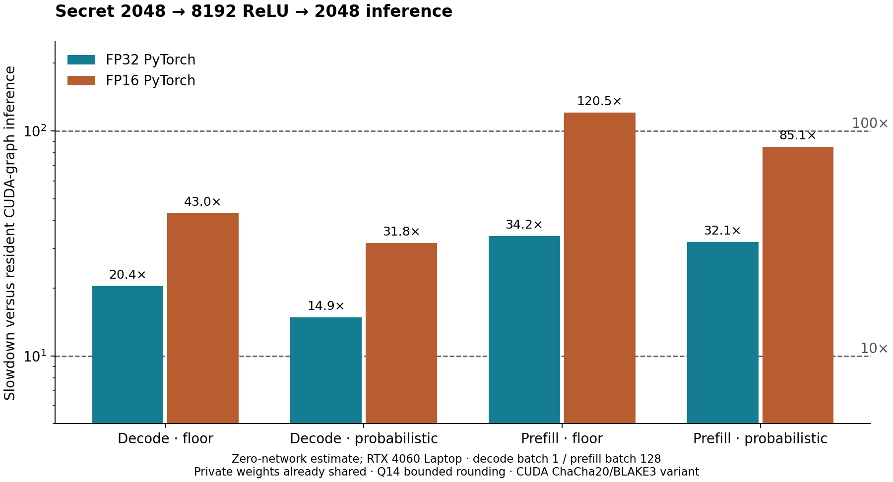

# Rep4 GPU inference results

[Documentation index](README.md)

The GPU variant meets the **less than 100×** target for the tested decode and
prefill blocks against both FP32 and FP16 PyTorch under a zero-network timing
model. This uses bounded probabilistic Q14 rounding. Exact floor rounding meets
the decode target but remains about 120× FP16 for prefill. A checked
4096 × 4096 matrix-vector product also meets the preferred **less than 10×**
target. Complete inference has not reached 10× FP16.

These results come from one RTX 4060 Laptop GPU with 8 GB of memory. The
four-party runtime executes real masks, messages, integrity checks, and secret
arithmetic. The independent-GPU numbers below are **estimates from isolated
party replay**, not measurements on four networked GPUs.

## Inference latency

The network is a secret-weight 2048 → 8192 ReLU → 2048 feed-forward block.
Inputs, both weight matrices, and both biases are privately shared. Floor mode
uses exact signed Q14 rescaling; its outputs equal the integer reference.
Probabilistic mode rounds each rescaling to its floor or ceiling, with unbiased
rounding under uniform fresh masks. Its outputs satisfy propagated integer
bounds and agree at all parties. Decode has batch size 1; prefill has batch size 128.

| Runtime and workload | Zero-network estimate | Versus FP32 graph | Versus FP16 graph | Measured four roles on one GPU | Evidence |
| --- | ---: | ---: | ---: | ---: | --- |
| BLAKE2b, ring32 decode | 14.91 ms | 23.0× | 46.9× | 65.85 ms | [JSON](../experiments/results/inference/inference_decode2048_ring32_q14.json) |
| BLAKE2b, ring64 decode | 20.90 ms | 33.3× | 65.8× | 77.19 ms | [JSON](../experiments/results/inference/inference_decode2048_ring64_q14.json) |
| BLAKE2b, ring32 prefill | 579.64 ms | 503.6× | 1681.0× | 1451.02 ms | [JSON](../experiments/results/inference/inference_prefill2048_ring32_q14.json) |
| GPU BLAKE3, floor decode | 13.70 ms | 20.4× | 43.0× | 79.51 ms | [JSON](../experiments/results/inference/final_device_floor_decode.json) |
| GPU BLAKE3, floor prefill | 42.62 ms | 34.2× | 120.5× | 181.62 ms | [JSON](../experiments/results/inference/final_device_floor_prefill.json) |
| GPU BLAKE3, probabilistic decode | 10.11 ms | 14.9× | 31.8× | 54.51 ms | [JSON](../experiments/results/inference/final_device_prob_decode.json) |
| GPU BLAKE3, probabilistic prefill | 29.51 ms | 32.1× | 85.1× | 123.56 ms | [JSON](../experiments/results/inference/final_device_prob_prefill.json) |



The BLAKE2b runtime retains MP-SPDZ's core message encodings and consistency
digests. Its benchmark uses AES-256-CTR correlated masks. The experimental GPU
runtime replaces mask generation with CUDA ChaCha20 and online digests with
BLAKE3, including its optional device-side output check in these final runs.
It preserves recipients, six joint inputs per multiplication, and
32-byte tag sizes; its cryptographic bytes are deliberately different.
See the [device protocol](protocol/device-protocol.md).

The GPU BLAKE3 estimate assumes incoming online messages already reside on the
GPU. For the probabilistic variant, a replay that includes host staging instead
takes **12.16 ms for decode** and **51.58 ms for prefill**. That prefill result is
about **149× FP16**, so the GPU-incoming assumption matters to the target.
Physical GPUDirect networking is not implemented.
Both estimates exclude network latency and bandwidth. The measured four-role
column uses one shared GPU and includes contention between roles.

The probabilistic GPU decode is 3.31× the single-threaded NumPy baseline;
prefill is 0.323× NumPy. These CPU comparisons use the same
fixtures but are less demanding than FP16 CUDA inference. Floor mode's maximum absolute
log-probability error relative to FP32 is 0.00242 for decode and 0.00289 for
prefill. These are errors on generated fixtures, not language-model quality
measurements. Across the fresh probabilistic runs, the worst absolute
log-probability errors are 0.00252 for decode and 0.00291 for prefill.

The probabilistic prefill bound is 664,019,065 in encoded accumulator units,
strictly below its quarter-ring limit of 1,073,741,824. Propagated output
intervals span at most 40 Q14 integer units. The runtime does not privately
check this range for arbitrary models; the benchmark establishes it from its
public fixture before any sharing.

Exact prefill sends 352.72 MB of application payload globally in 25 rounds;
probabilistic prefill sends 239.60 MB in 20 rounds. Actual network bandwidth and
round latency remain additional deployment costs.

## Best recorded decode

The [packed runtime measurement](../experiments/results/kernels/rep4_packed_final.json) records the
best saved private ReLU decode estimate: **3.007 ms**, or **10.75×** its
0.2797 ms FP16 graph baseline. Host-staged replay takes 3.953 ms; four roles
on one GPU take 16.951 ms. The later Strassen and narrow-correction experiment
improves prefill but establishes no decode gain over this run.

## Sparse products and activation experiments

The optional `sparse_products=True` path removes two public-zero contributions
from selected truncation, bounded-sign, and conversion products. Its balanced
four-contribution route preserves the existing Rep4 sharing model and the
rounding contract. It reduces prefill traffic from 200.54 MB to **176.95 MB**
with 20 rounds unchanged. A [nine-sample ReLU run](../experiments/results/activations/activation_inference.json)
measures 3.242 ms decode and 19.031 ms prefill. The earlier packed run measured
3.007 and 19.535 ms; these separate runs establish no decode latency gain.
The [protocol description](protocol/device-protocol.md#products-with-public-zero-components)
specifies the public support invariant and altered mask schedule.

The activation experiments use the same 2048 → 8192 → 2048 secret-weight
fixture, Q14 ring32, prepared GPU graphs, fresh masks, and checked output
opening. No TEE was used. The table reports GPU-delivered isolated-party
estimates; all network latency and bandwidth are excluded.

| Activation path | Decode | Prefill | Rounds | Prefill traffic | Prefill logit RMSE | Prefill top-1 agreement |
| --- | ---: | ---: | ---: | ---: | ---: | ---: |
| Private ReLU with sparse products | 3.242 ms | 19.031 ms | 20 | 176.95 MB | 0.000633 | 100% |
| Private local quadratic GELU | 2.929 ms | 17.718 ms | 14 | 155.19 MB | 0.023282 | 89.84% |
| Private local quadratic SiLU | 3.009 ms | 17.784 ms | 14 | 155.19 MB | 0.011026 | 92.19% |
| Public-fixture helper simulation, ReLU | 2.611 ms | 14.085 ms | 9 | 79.69 MB | 0.000633 | 100% |

Accuracy compares each case with its original floating activation. These are
synthetic FFN outputs, not trained language-model accuracy. The two local
polynomials are `x/2 + 3*x*x/8` for GELU and `x/2 + x*x/4` for SiLU. They
need one secret square and avoid secure comparisons, but change the network
function. On a dense `[-4,4]` grid their maximum activation errors are 4.00013
and 2.07195 respectively. They work better near zero and do not clip tails.
The earlier uniform quadratics give much poorer fixture quality: prefill top-1
agreement is 35.94% for GELU and 56.25% for SiLU. See the
[activation API and contracts](arithmetic/activations.md),
[uniform measurements](../experiments/results/activations/activation_inference.json), and
[local measurements](../experiments/results/activations/activation_local_inference.json).

The [helper simulation](../experiments/results/activations/activation_simulated_inference.json) executes
two ordinary GPU helpers that reconstruct the activation, floor-rescale it,
apply ReLU, and create fresh full four-component output shares. It includes
actual masks, hashes, reconstruction, and resharing. It provides **no enclave
isolation or activation privacy**. This changed trust model cannot be reported
as a faster private Rep4 implementation. Its activation route costs eight
ring words per element globally plus 128 tag bytes in two exchanges; the
complete inference retains the later private rescaling and checked opening.
The [simulation guide](experiments/activation-helper-simulation.md) describes the route
and its limitations.

Against each run's original-activation FP16 graph baseline, the simulation is
9.34× for decode and 32.10× for prefill. Local quadratic GELU is 10.47× and
45.04×; local quadratic SiLU is 10.67× and 35.10×. FP16 prefill timing varies
between runs, so latency and quality columns are more useful than comparing
these ratios directly. The simulated ReLU latency is 19.5% lower for decode
and 26.0% lower for prefill than the sparse ReLU measurement. The **less than
10× target for both workloads remains unmet**.

### Blinding and duplicated helpers

The [public blinding experiments](../experiments/results/activations/activation_blinding_public_gpu.json)
expose the limits of shift, scale, and permutation masking. Softmax shift and
permutation preserve sorted gaps and the probability multiset. Large shifts
can also lose floating-point precision: the FP16 offset example changes a
probability by 0.332. RMS scaling preserves normalized ratios; fixed epsilon
breaks exact invariance, while revealing scaled epsilon can disclose the
scale. Permutation and padding leave actual GELU inputs visible within a
larger multiset. These transformations do not hide all activation information
from a compromised helper.

Duplicate deterministic execution and matching output hashes detect some
inconsistent results, but cannot detect identical errors or establish privacy.
The public replica experiment enforces fresh nonces and rejects independent
corruption; it implements no enclave or attestation. Slalom's
[TEE-assisted design](https://www.floriantramer.com/docs/papers/iclr19slalom.pdf)
places the remaining network computation inside its trusted environment and
outsources linear layers; it does not establish that these blinding transforms
protect activations from a compromised TEE. For a pure MPC direction,
[Compact](https://petsymposium.org/popets/2024/popets-2024-0065.php) studies
input-distribution-aware piecewise polynomials. Its reported model quality
does not validate the quadratics used here.

The [phase-deletion counterfactual](../experiments/results/activations/activation_cost_bounds.json)
puts prefill at 10.46 ms even if the first activation stage were free. Its two
matrix phases alone total 9.66 ms. These estimates delete existing phases and
are not measurements of a replacement protocol, but they show why activation
work alone does not close the prefill gap. The
[combined summary](../experiments/results/activations/activation_summary.json) retains measured results,
quality metrics, source hashes, and evidence links.

The combined regression passes **738 tests** in 137.52 seconds, including
fresh-mask integer oracles, full-width sparse products, phase-graph replay,
corruption rejection, trained fixtures, and socket execution. The 12 warnings
are empty CUDA graph segments for roles without local work between exchanges.
See the [validation log](../experiments/results/validation/logs/activation_full_validation.log) and
[successful exit status](../experiments/results/validation/logs/activation_full_validation.status).

## Exact Strassen products and narrower truncation corrections

The private ReLU path now has two exact matrix improvements and an optional
smaller truncation correction. The SM89 compact-weight kernel uses explicit
modular additions and a `32/128/32` tile. The optional `strassen32` format adds
one level of batched matrix Strassen with cached static weight combinations.
Neither matrix change alters the local ring products, rounding, wire bytes,
or cryptographic checks. `narrow_products=True` changes selected correction
messages to 16-bit arithmetic while preserving the probabilistic rounding law.
The [kernel guide](arithmetic/kernel-arithmetic.md) and
[truncation contract](protocol/device-protocol.md#narrow-truncation-correction-products)
explain the identities and input requirements.

| Workload and storage | GPU-delivered estimate | FP16 graph baseline | Slowdown | Host-staged estimate | Four roles on one GPU |
| --- | ---: | ---: | ---: | ---: | ---: |
| Decode, `words32`, narrow corrections | 3.354 ms | 0.2796 ms | 12.00× | 4.183 ms | 16.803 ms |
| Prefill, `words32`, modular-add kernel | 17.642 ms | 0.3736 ms | 47.22× | 33.006 ms | 79.119 ms |
| Prefill, `strassen32`, modular-add kernel | **16.432 ms** | 0.3542 ms | **46.39×** | 31.160 ms | 71.536 ms |

These [nine-sample compact-weight measurements](../experiments/results/kernels/rep4_narrow_opaque.json)
and [Strassen measurement](../experiments/results/kernels/rep4_strassen_narrow.json) include narrow
corrections, fresh masks, checked output opening, and the original private
ReLU activation. All outputs agree across parties and remain inside the same
public Q14 rounding bounds. Maximum log-probability error is 0.002512 for
decode and 0.002906 for prefill, with 100% top-1 agreement on the synthetic
fixture. No polynomial substitution or trusted-helper reconstruction is used.

Compared with the earlier sparse-product run at 19.031 ms, Strassen prefill
latency is 13.7% lower. These are separate runs; their FP16 baselines also vary.
The current decode run establishes no latency gain over the earlier 3.007 ms
packed configuration. The less than 10× target remains unmet for both
workloads. The current Strassen matrix phases alone total 7.529 ms, above the
3.542 ms budget for the entire prefill block to meet 10× its FP16 baseline.

The [alternating modular-add comparison](../experiments/results/kernels/opaque_ring32_paired.json)
measures 5.271 → 4.738 ms and 5.510 → 4.969 ms for the two local matrix shapes,
about 10% lower each. The [alternating Strassen comparison](../experiments/results/kernels/rep4_strassen_opaque_paired.json)
then measures 4.732 → 3.796 ms and 4.794 → 4.019 ms relative to that optimized
kernel. Every measured full-ring output matches exactly. Separate contribution
launches regressed; two Strassen levels also regressed the down projection.
Neither is selected by inference dispatch.

Strassen increases retained model storage from 402,653,184 to 704,643,072 bytes
per party, or 1.75 times the compact format. The four colocated roles retain
2,818,572,288 weight bytes. All query-dependent input sums and output joins
remain inside inference timing; only static weight sums are prepared once.
Single-row decode uses `words32`; the Strassen format requires even batch and
matrix dimensions.

Narrow correction products reduce prefill payload from 176,949,760 to
166,464,000 bytes globally, a 5.93% reduction, with 20 rounds unchanged. They
use separate mask domains and full 32-byte tags. For a correction multiplied
by `-2**(bits-shift)`, a lift error divisible by `2**16` vanishes in the full
ring whenever `shift <= 16`. Larger shifts keep the full-width route.

Reproduce the Strassen prefill case from the repository root:

```sh
python -m experiments.benchmarks.inference.device_inference --batch 128 --width 2048 \
  --bits 32 --binary-bits 32 --fractional-bits 14 \
  --prepared --weight-storage strassen32 --optimized --gpu-open \
  --rounding probabilistic --bounded-sign --phase-graphs \
  --graph-check-at-send --sparse-products --narrow-products --repeats 9 \
  --output experiments/results/kernels/rep4_strassen_narrow.json
```

The [combined report](../experiments/results/kernels/rep4_strassen_narrow_summary.json) retains source
hashes, phase estimates, storage costs, and validation evidence.

The final regression passes **895 tests** in 91.65 seconds. It includes
full-width integer matrix oracles, the saturation regression, Strassen
transcript parity, independent ChaCha20/BLAKE3 narrow-product oracles,
corrupted-message rejection, fresh graph inputs, trained fixtures, and socket
execution. The 12 warnings are empty CUDA graph segments for roles with no
local work between exchanges. See the
[validation log](../experiments/results/validation/logs/rep4_strassen_narrow_validation_final.log) and
[exit status](../experiments/results/validation/logs/rep4_strassen_narrow_validation_final.status).

## Matrix multiplication

For a secret `(1, 4096) @ (4096, 4096)` product in ring32, the checked
zero-network estimate is **1.326 ms**, or **3.82× FP32 and 8.29× FP16**
CUDA-graph matrix multiplication. The measured four-role colocated time is
4.885 ms. It sends 98,496 application bytes globally in one communication
round. This timer includes masks, BLAKE2b checks, and resharing; output opening
is verified separately and excluded from this primitive's timer.
[Nine-sample evidence](../experiments/results/kernels/primitives_decode_words32.json).

Prepared weights store each ring32 component in four bytes. A party holds
three components, so its resident weight storage is six times that of a
single FP16 plaintext weight matrix. The decode kernel computes the three
local multiplication contributions directly from those words. Larger matrix
products use exact balanced int8 limb products and tensor cores; they do not
cast secret ring values to approximate floating-point arithmetic.

## Correctness and communication evidence

- An independent Rep4 oracle compares recipients, protocol phases, payloads,
  digests, and local replicated components. Input ownership and checked opening
  are covered separately. Transport framing is custom, so this is application
  protocol correspondence rather than binary interoperability with MP-SPDZ.
- Actual four-party MP-SPDZ executables pass the retained ring32/ring64
  arithmetic and fixed-point fixtures. The installed snapshot's optimized
  ring32 binary composition fails a boundary fixture; its failure is retained,
  and the passing ring32 golden uses generic per-bit conversion.
  [Golden report](../tests/fixtures/mpspdz/report.md).
- The trained synthetic 16 → 64 ReLU → 8 next-token MLP matches all **512
  integer logits across 64 contexts** on CPU, CUDA, and native ring32/ring64
  MP-SPDZ. Both floating-point and private fixed-point inference attain 100%
  accuracy on these training contexts; no held-out result is claimed.
  [Example](../experiments/examples/README.md), [whole-network golden](../tests/fixtures/mpspdz/toy_ffn_report.md).
  The fast CUDA-crypto path also passes every context in both ring sizes:
  floor mode matches all integer logits, and probabilistic mode stays within
  the proved intervals while retaining 100% classification accuracy.
- Separate processes complete private inference over mutually authenticated
  TLS with distributed correlated-seed setup and checked outputs.
  [Socket report and logs](../experiments/results/transport/socket_inference_report.md).
- The GPU crypto variant has independent CPU ChaCha20/BLAKE3 transcript
  comparisons and malformed-message tests. Hash tests cover partial blocks,
  odd trees, multi-megabyte inputs, streams, and deterministic graph replay.
  Live protocol graph replay must not freeze and reuse mask nonces.

Exact carry-based truncation and weighted binary-to-arithmetic conversion are
protocol optimizations. Their arithmetic matches the golden; their complete
activation traffic differs from MP-SPDZ's default circuits. ReLU is exact.
GELU and SiLU use documented polynomial approximations, and a polynomial
composition API supports other approximations. [Activation contracts](arithmetic/activations.md).

## Timing boundaries and reproduction

Input sharing, model sharing, static weight preparation, and JIT compilation
are outside resident-model inference timing. Inference includes its checked
final opening. Each live execution uses fresh masks. Replay restores a fixed
public fixture solely to measure one role at a time, verifies outgoing bytes
during warmup, and retains actual cryptographic computation. The estimate sums
the maximum per-role median for each protocol phase. It excludes inter-party
network transfer time and does not demonstrate a functioning network pipeline.

PyTorch comparisons include eager and resident CUDA-graph measurements; the
table uses graph device time. FP32 disables TF32. NumPy BLAS and PyTorch CPU
threads are limited to one. Each JSON retains samples, phase timings, range
checks, package versions, source hashes, baseline errors, and separate setup
costs. Model sharing and static preparation can be amortized over reuse of the
shared model. Private-input sharing recurs for each fresh request and must be
added to an end-to-end latency estimate. A one-shot run must also include model
setup and compilation.

Eager inference can be faster than a captured graph for a particular shape.
Probabilistic prefill is 32.51× FP32 eager and 81.60× FP16 eager, so its target
does not depend on selecting the graph baseline. FP32 graph denominators vary
across runs; the JSON files retain each measured denominator rather than
replacing it with a common value.

After [installation](../README.md#run-locally), run from the repository root:

```sh
python -m experiments.benchmarks.inference.inference --device cuda --bits 32 --binary-bits 32 \
  --fused --prg aes --truncation compact --fractional-bits 14 \
  --prepared --weight-storage words32 --batch 1 --width 2048 --repeats 7 \
  --output experiments/results/inference/inference-reproduction.json

python -m experiments.benchmarks.inference.device_inference --bits 32 --binary-bits 32 \
  --fractional-bits 14 --prepared --weight-storage words32 \
  --optimized --gpu-open --rounding probabilistic \
  --batch 128 --width 2048 --repeats 5 \
  --output experiments/results/inference/device-reproduction.json

python -m pytest -q
```

The public fixture bounds fit ring32 at Q14. This does not justify ring32 or
the same precision for arbitrary models: signed accumulators must fit before
rescaling. Ring64 is available when more headroom is needed.

## Security scope and remaining work

Rep4 protects against one malicious party among four. Two colluding parties
can reconstruct the shared inputs. The helper simulations have separate trust
assumptions and do not implement an enclave or preserve activation privacy.

The implementation supports dense layers, exact ReLU, fixed-point composition,
and approximate GELU/SiLU. Full transformers, attention, authenticated inference
records, model binding, model-substitution detection, and physical multi-GPU
networking remain outside the implemented result.

The [MAMA mask-privacy finding](protocol/native-mama-sacrifice.md#mask-privacy-limitation)
preserves the security analysis of the removed preprocessing experiment.
